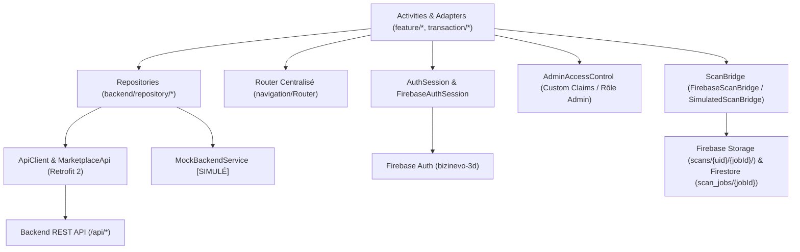

# Architecture Technique — Marketplace Android & Service d'Achat Agence Import 1688

## 1. Vue d'Ensemble

L'application Android **Marketplace** (`com.marketplace.app`) est organisée dans un module unique `:app` en Java 17. Elle combine :
1. **Marketplace Locale (inspirée de Deal.mg)** : Catalogue multi-vendeurs, recherche, filtres, panier, passage en caisse, commandes, contact vendeur (WhatsApp, Messenger, Appel), et visualisation AR 3D / scan 3D Meta SAM.
2. **Service d'Achat Agence « Import 1688 »** : Accessible depuis le **gros bouton central circulaire « Import 1688 »** de la barre de navigation inférieure (`Accueil`, `Catégories`, **`Import 1688`**, `Panier`, `Mon compte`).
   - Notre agence réalise une **prestation d'achat sur 1688.com** pour le compte du client (avec la carte bancaire de l'agence) après paiement par **MVola** et fait livrer la marchandise chez un **importateur / transitaire désigné**.
   - Notre agence ne gère pas le transport international Chine → Madagascar : une fois le colis reçu par l'importateur (`RECU_PAR_IMPORTATEUR`), le client contacte directement l'importateur pour payer les frais de transport international.



---

## 2. Organisation des Packages (`com.marketplace.app`)

```text
com.marketplace.app/
├── base/
│   ├── BaseModel.java                 --> Classe de base des modèles (validation)
│   ├── BaseRepository.java            --> Gestion centralisée HTTP/erreurs (400/401/403/404/500) et callbacks
│   ├── BaseActivity.java              --> Cycle de vie UI, loading, requireLogin
│   └── BaseAdapter.java               --> Adapter générique RecyclerView
│
├── model/
│   ├── User.java, UserRole.java       --> Utilisateur (BUYER, SELLER, PRO)
│   ├── Product.java, Category.java    --> Fiches articles, prix en Ariary, modèles 3D (.glb)
│   ├── Cart.java, CartItem.java       --> Panier d'achat
│   ├── Order.java, OrderItem.java     --> Commandes marketplace locale
│   ├── Payment.java, PaymentStatus.java--> Paiements (EN_ATTENTE, PAYE, ECHOUE)
│   ├── ContactRequest.java            --> Demandes de contact vendeur
│   ├── ScanJob.java, ScanJobStatus.java--> Suivi de numérisation 3D
│   ├── ImportOrder.java               --> Modèle complet d'une commande d'achat 1688 (22 champs + validation)
│   ├── ImportTrackingStatus.java      --> Les 6 états officiels du suivi Import 1688
│   ├── ImportStatusHistoryEntry.java  --> Historique horodaté (status, date, time, note, updatedByAdmin)
│   └── ImportAgencyConfig.java        --> Configuration taux CNY->MGA, compte MVola agence et importateur
│
├── backend/
│   ├── ApiClient.java                 --> Client Retrofit/OkHttp avec injection automatique du token Firebase
│   ├── AuthSession.java               --> Session unifiée (userId, idToken, currentUser)
│   ├── api/MarketplaceApi.java        --> Contrat Retrofit de toutes les routes REST
│   ├── repository/
│   │   ├── ProductRepository.java     --> Produits, recherche, filtres, PATCH model3d
│   │   ├── CartRepository.java        --> Panier et checkout
│   │   ├── OrderRepository.java       --> Commandes marketplace
│   │   ├── UserRepository.java        --> Profil utilisateur
│   │   ├── ContactRepository.java     --> Demandes de contact vendeur
│   │   ├── PaymentRepository.java     --> Paiements commandes locales
│   │   └── ImportOrderRepository.java --> Demandes d'achat 1688, MVola, achat réel 1688 et suivi 6 étapes
│   └── mock/MockBackendService.java   --> Simulation complète [SIMULÉ] pour les routes non encore déployées
│
├── feature/
│   ├── import1688/
│   │   ├── CurrencyConversionService.java    --> Conversion CNY (¥) -> Ariary (MGA) et calcul frais agence
│   │   ├── AdminAccessControl.java           --> Contrôle d'accès réel administrateur (Firebase claims / rôle)
│   │   ├── ImportOrdersAdapter.java          --> Cartes de commandes Import 1688 (double devise CNY/MGA)
│   │   ├── Import1688HomeActivity.java       --> Hub Import 1688, convertisseur rapide, réception liens partagés
│   │   ├── Import1688BrowserActivity.java    --> WebView 1688.com durcie (HTTPS strict, sans accès fichiers)
│   │   ├── Import1688RequestActivity.java    --> Formulaire de demande d'achat 1688 avec détail financier
│   │   ├── Import1688OrderDetailActivity.java--> Paiement MVola, suivi 6 étapes et contact importateur
│   │   └── Import1688AdminActivity.java      --> Interface Admin protégée (taux, MVola, achat 1688, suivi)
│   ├── auth/                          --> LoginActivity (avec reset password), RegisterActivity, ProfileActivity
│   ├── catalogue/                     --> CatalogueActivity, ProductDetailActivity, ProductPublishActivity
│   ├── boutique/                      --> BoutiqueActivity
│   ├── contact/                       --> ContactBottomSheet, ContactLinks
│   ├── scan3d/                        --> FirebaseScanBridge, SimulatedScanBridge, ScanCapture/StatusActivity
│   └── ar/                            --> ArLauncher, ArViewerActivity
│
├── transaction/                       --> CartActivity, CheckoutActivity, OrdersActivity, OrderDetailActivity
├── navigation/Router.java             --> Routeur statique centralisé
└── ui/                                --> PriceFormatter, PriceView, QuantityStepper, SellerBadge, StateLayout
```

---

## 3. Spécification API REST pour le Backend (`backend/`)

Conformément à la règle d'architecture interdisant toute modification du dossier `backend/`, voici la spécification exacte des routes complémentaires consommées par `MarketplaceApi.java` :

### 3.1 Module Service d'Achat Agence « Import 1688 »
- **`GET /api/import1688/config`** : Retourne `ImportAgencyConfig` (`exchangeRateCnyToMga`, `exchangeRateUpdatedAt`, `defaultServiceFeePercent`, `mvolaPhoneNumber`, `mvolaBeneficiaryName`, `mvolaInstructions`, `importerName`, `importerCompany`, `importerPhone`, `importerWhatsapp`, `importerAddress`, `importerInstructions`).
- **`PUT /api/import1688/config`** *(Admin requis)* : Met à jour le taux de change CNY → MGA, la commission d'agence, le compte MVola et les coordonnées de l'importateur.
- **`POST /api/import1688/orders`** *(Auth requis)* : Crée une demande d'achat 1688 (`ImportOrder`) avec statut initial `paymentStatus = EN_ATTENTE` et `trackingStatus = PAIEMENT_EN_ATTENTE`.
- **`GET /api/import1688/orders?role=customer|admin&q=...`** *(Auth requis)* : Liste les demandes du client connecté (ou toutes les commandes si `role=admin` et jeton administrateur vérifié).
- **`GET /api/import1688/orders/:id`** *(Auth requis)* : Détail complet d'une commande `ImportOrder` et de son `statusHistory`.
- **`PATCH /api/import1688/orders/:id/confirm-amount`** *(Admin requis)* : Corps JSON `{"priceCNY": number, "exchangeRate": number, "serviceFeeMGA": number}` → confirme `totalAmountMGA` et `amountConfirmedByAdmin = true`.
- **`POST /api/import1688/orders/:id/payment-reference`** *(Auth client requis)* : Corps JSON `{"paymentReference": "..."}` → enregistre la référence MVola tout en maintenant `paymentStatus = EN_ATTENTE`.
- **`PATCH /api/import1688/orders/:id/verify-payment`** *(Admin requis)* : Corps JSON `{"paymentStatus": "PAYE"|"ECHOUE", "note": "..."}` → passe à `PAIEMENT_CONFIRME` si `PAYE`.
- **`PATCH /api/import1688/orders/:id/purchase`** *(Admin requis)* : Corps JSON `{"supplierOrderReference": "...", "actualPurchasePriceCNY": number, "purchaseDate": "YYYY-MM-DD", "note": "..."}` → enregistre l'achat réel sur 1688 par carte agence et passe à `ACHAT_EFFECTUE`.
- **`PATCH /api/import1688/orders/:id/tracking`** *(Admin requis)* : Corps JSON `{"trackingStatus": "PREPARATION_FOURNISSEUR"|"EXPEDIE_VERS_IMPORTATEUR"|"RECU_PAR_IMPORTATEUR", "note": "..."}` → ajoute une entrée horodatée dans `statusHistory`.

### 3.2 Demandes de Contact Vendeur & Paiements Commandes Locales
- **`POST /api/contact-requests`**, **`GET /api/contact-requests/buyer`**, **`GET /api/contact-requests/seller`**.
- **`POST /api/orders/:id/payment`**, **`GET /api/orders/:id/payment`**, **`PATCH /api/orders/:id/payment/status`**.

---

## 4. Configuration Firebase (`bizinevo-3d`) & Règles de Sécurité

- **Projet Firebase** : `bizinevo-3d` (Package `com.marketplace.app`).
- **Authentification** : Email/Mot de passe (avec réinitialisation par email) et Google Sign-In (`126516143083-fd3n9281tbr4n6k736888p2d24qic26g.apps.googleusercontent.com`), synchronisés via `FirebaseAuthSession` vers `AuthSession` et `AdminAccessControl`.
- **Scan 3D** :
  - Firebase Storage : `scans/{uid}/{jobId}/frame_{i}.jpg` (protégé par `storage.rules`).
  - Cloud Firestore : `scan_jobs/{jobId}` contenant `userId`, `productId`, `status`, `progress`, `photoUrls`, `modelUrl`, `createdAt` (protégé par `firestore.rules`).
