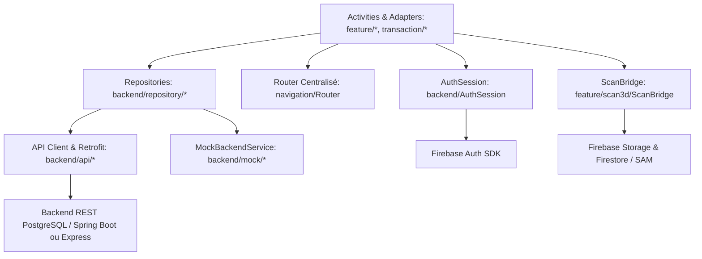

# Architecture Technique - Marketplace Android

## 1. Vue d'Ensemble

L'application Android **Marketplace** est conçue selon une architecture modulaire interne propre regroupée dans le module unique `:app`. Elle respecte scrupuleusement la séparation des responsabilités, le contrat REST du backend PostgreSQL (`backend/README.md`), et l'authentification Firebase Auth.



---

## 2. Organisation des Packages (`com.marketplace.app`)

```text
com.marketplace.app/
├── base/
│   ├── BaseModel.java            --> Base pour tous les modèles (Serializable, validation)
│   ├── BaseRepository.java        --> Gestion centralisée HTTP/erreurs et callbacks
│   ├── BaseActivity.java          --> Cycle de vie UI, loading, empty/error states, requireLogin
│   └── BaseAdapter.java           --> Adapter générique avec click listeners et empty support
│
├── model/
│   ├── User.java, UserRole.java   --> Modèle utilisateur (BUYER, SELLER, PRO) et profils
│   ├── Product.java, Category.java--> Fiches articles, prix en Ariary, modèles 3D (.glb)
│   ├── Cart.java, CartItem.java   --> Panier d'achat côté client / serveur
│   ├── Order.java, OrderItem.java --> Commande multi-vendeur, statuts, historique
│   ├── Payment.java               --> Paiement déclaratif/simulé (MVOLA, Orange, Airtel, Livraison)
│   ├── ContactRequest.java        --> Demande de contact acheteur-vendeur (WhatsApp, Messenger, Appel)
│   ├── FilterCriteria.java        --> Filtres par mot-clé, catégorie, prix, AR uniquement
│   └── ScanJob.java               --> Suivi de numérisation 3D (PENDING, PROCESSING, COMPLETED)
│
├── backend/
│   ├── api/
│   │   ├── ApiClient.java         --> Factory Retrofit 2 avec Gson et timeouts
│   │   └── MarketplaceApi.java    --> Interface exhaustive des endpoints REST
│   ├── repository/
│   │   ├── ProductRepository.java --> Gestion des produits, recherche et filtres
│   │   ├── CartRepository.java    --> Panier, ajouts, suppressions, checkout
│   │   ├── OrderRepository.java   --> Suivi des commandes, annulation, mise à jour de statut
│   │   ├── UserRepository.java    --> Synchronisation du profil métier
│   │   ├── ContactRepository.java --> Création et consultation des demandes de contact
│   │   └── PaymentRepository.java --> Déclaration et suivi des paiements
│   ├── mock/
│   │   └── MockBackendService.java--> Simulation complète in-memory pour soutenance hors-ligne
│   └── AuthSession.java           --> Source unique de vérité de session (userId, token, statut)
│
├── navigation/
│   └── Router.java                --> Centralisation de tous les intents de navigation
│
├── transaction/
│   ├── panier/
│   │   ├── CartActivity.java      --> Écran panier avec totaux dynamiques
│   │   └── CartAdapter.java       --> Gestion des quantités et suppressions
│   ├── commande/
│   │   ├── CheckoutActivity.java  --> Écran de validation et choix d'adresse / contact
│   │   ├── OrdersActivity.java    --> Écran historique des commandes acheteur/vendeur
│   │   └── OrdersAdapter.java     --> Affichage du statut des commandes
│   └── paiement/
│       ├── PaymentProvider.java   --> Interface de passerelle de paiement
│       └── SimulatedPaymentProvider.java --> Simulation immédiate ou asynchrone sécurisée
│
├── feature/
│   ├── auth/
│   │   ├── LoginActivity.java     --> Connexion email/password et raccourcis
│   │   ├── RegisterActivity.java  --> Inscription nouvel utilisateur
│   │   ├── ProfileActivity.java   --> Profil, passage au statut vendeur, déconnexion
│   │   └── FirebaseAuthSession.java--> Passerelle Firebase Auth vers AuthSession
│   ├── catalogue/
│   │   ├── CatalogueActivity.java --> Accueil commercial style 1688, grille produits, filtres
│   │   ├── ProductDetailActivity.java --> Fiche produit complète, bouton AR, ajout panier, contact
│   │   ├── ProductCardAdapter.java--> Carte produit avec affichage prix, badge AR et vendeur
│   │   └── ProductPublishActivity.java--> Formulaire de mise en vente d'un article
│   ├── boutique/
│   │   └── BoutiqueActivity.java  --> Vitrine d'un vendeur donné avec ses articles
│   ├── contact/
│   │   ├── ContactBottomSheet.java--> Modal d'options de contact (WhatsApp, Messenger, Appel)
│   │   └── ContactLinks.java      --> Générateur sécurisé d'URI et d'URL pour le contact direct
│   ├── scan3d/
│   │   ├── ScanBridge.java        --> Contrat de téléversement et suivi du scan 3D SAM
│   │   ├── SimulatedScanBridge.java--> Simulation de numérisation 3D pour la soutenance
│   │   ├── FirebaseScanBridge.java--> Pont réel Firebase Storage / Firestore
│   │   ├── ScanCaptureActivity.java--> Capture photo 360° du produit physique
│   │   └── ScanStatusActivity.java --> Progression du traitement IA (Meta SAM)
│   └── ar/
│       ├── ArLauncher.java        --> Détection ARCore, lancement Scene Viewer / AR local
│       ├── ArViewerActivity.java  --> Surface AR / aperçu du modèle 3D
│       └── ProductVisionChecker.java--> Vérification de compatibilité de l'appareil
│
└── ui/
    ├── PriceFormatter.java        --> Formatage uniforme Ariary (ex: "150 000 Ar")
    ├── PriceView.java             --> Composant graphique pour prix et devise
    ├── SellerBadge.java           --> Badge stylisé pour le rôle vendeur / boutique
    ├── QuantityStepper.java       --> Contrôle d'incrément/décrément de quantité
    └── StateLayout.java           --> Gestion centralisée chargement, vide et erreur
```

---

## 3. Flux de Données et Sécurité

1. **Session Unique** :
   - `AuthSession` est le seul point de vérité.
   - Initialisé automatiquement par `FirebaseAuthSession` lors des changements d'état Firebase (`onAuthStateChanged`).
   - L'identifiant utilisateur (`userId`) est transmis dans les headers HTTP `Authorization: Bearer <token>` ou `X-User-Id`.
   - Les activités protégées appellent `requireLogin(() -> action())` hérité de `BaseActivity`.

2. **Mode Démonstration Hors-Ligne (Mock)** :
   - Contrôlé dynamiquement par `ApiClient.setUseMock(true)` ou via `MarketplaceApp`.
   - Permet une démonstration complète en soutenance même en cas de coupure de réseau ou de serveur local éteint.
   - Les modifications en mémoire (panier, réservations de stock, création de commande, paiement) sont persistées durant toute la session.

3. **Intégration AR 3D & SAM** :
   - Les produits disposant d'un modèle 3D valide (`.glb`) affichent un badge AR.
   - Le bouton "Essayer en AR" interroge `ArLauncher.launchArViewer(...)`. Si Google Play Services for AR (ARCore) est disponible, Scene Viewer ou l'activité locale est invoquée.
   - La numérisation 3D (`ScanBridge`) envoie les prises de vue vers Firebase Storage, notifie Firestore pour le script IA SAM, et récupère l'URL du fichier `.glb` finalisé.
